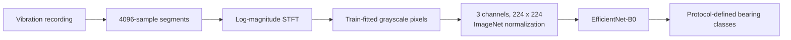
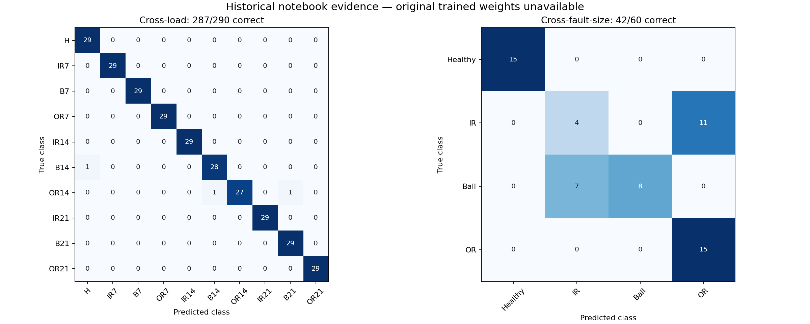

# CWRU bearing diagnosis and generalization

This undergraduate research project asks how bearing-fault classification changes when operating load or fault size differs from the training data. These changes matter because a classifier that separates one laboratory subset well may rely on features that do not transfer to another. The study uses selected vibration recordings from the Case Western Reserve University Bearing Data Center.

The research progression is waveform analysis → FFT → envelope analysis → bearing characteristic frequencies → classical features/SVM → STFT → EfficientNet-B0. The early spectral methods and frequency rules are documented in the [exploration guide](docs/exploration.md). Simple amplitude features performed well on a fixed-size subset but transferred poorly across fault sizes. Later experiments used STFT spectrograms and EfficientNet-B0 transfer learning to examine two specific generalization settings. The notebooks retain this progression and explain both the findings and their limits.



The diagram describes the CNN experiments. Inputs are grayscale spectrograms replicated into three channels for the ImageNet-pretrained network; false-color plots are not model inputs. Exact transform order and training stages are documented in the [protocol guide](docs/protocols.md).

## Findings

| Final experiment | Correct test windows | Accuracy | Macro-F1 |
|---|---:|---:|---:|
| Cross-load | 287 / 290 | 98.97% | 98.96% |
| Cross-fault-size | 42 / 60 | 70.00% | 68.38% |

These are saved historical notebook results. The original trained weights are unavailable, and no new full training run has independently reproduced these evaluations. The experiments use different class definitions, sample counts, and protocols; their scores do not prove that fault-size shifts are intrinsically harder than load shifts.



Rows show true classes and columns show predictions. Cross-load made three errors. In cross-fault-size, 11 of 15 inner-race windows were predicted as outer-race faults, while seven ball-fault windows were predicted as inner-race faults. Healthy windows were all correct; accuracy on faulty windows alone was 27/45, or 60%. The figure summarizes archived predictions rather than a new model evaluation.

## Start with the notebooks

Begin with notebook 01 for the research progression, or notebook 04 to inspect the final cross-load experiment. With their default settings, the notebooks require no raw recordings, generate no image dataset, and perform no training. Notebooks 01 and 02 include clearly labeled numerical illustrations.

| Notebook | What it explains |
|---|---|
| [01 — Signal exploration](notebooks/01_signal_exploration.ipynb) | Waveforms, FFT, Hilbert envelopes, bearing-frequency targets, and exploratory rules |
| [02 — Classical baselines](notebooks/02_classical_baselines.ipynb) | Statistical features and three distinct historical SVM protocols |
| [03 — STFT exploration](notebooks/03_stft_exploration.ipynb) | Time-frequency resolution, A/B settings, and sampling-rate interpretation |
| [04 — Cross-load](notebooks/04_cross_load.ipynb) | Recording-disjoint load splits, saved findings, and optional execution |
| [05 — Cross-fault-size](notebooks/05_cross_fault_size.ipynb) | Size-transfer errors, healthy-record reuse, and optional execution |

Use a source checkout with an editable installation. Configurations and manifests live beside the code, so a standalone wheel is not a supported distribution. Automated execution of the default notebook cells was checked on Windows with Python 3.13.2. From the checkout root in PowerShell:

```powershell
py -3.13 -m venv .venv
.\.venv\Scripts\python.exe -m pip install -r requirements-notebooks-windows.txt
.\.venv\Scripts\python.exe -m pip install -e ".[notebooks]"
.\.venv\Scripts\python.exe -m jupyter lab --ServerApp.root_dir=. notebooks/01_signal_exploration.ipynb
```

The version file records the tested notebook packages, not the original research environment. Other platforms are described in the execution guide and have not been verified here.

See [installation and execution](docs/reproduction.md) for the Windows CPU reference route, Colab setup, data preparation, and opt-in training. Model execution also requires a compatible PyTorch/torchvision pair. Reading saved results needs neither recordings nor model weights. Optional raw-signal views and image generation require the listed MATLAB recordings; new model training requires generated images and may download ImageNet weights on first use. The [validation report](docs/validation_report.md) distinguishes tested paths from unverified environments.

## What the protocols measure

Cross-load uses ten classes combining bearing condition and fault size. Loads 0 and 1 provide training recordings, load 2 provides validation recordings, and load 3 provides test recordings. The split contains 580/290/290 non-overlapping windows. Recording separation does not establish independence between physical bearing instances.

Cross-fault-size uses four condition classes at load 0. Fault sizes .007, .014, and .021 inch provide training, validation, and test faults respectively. Each split contains 60 windows. Different healthy portions come from the same recording, so gaps prevent window overlap without establishing recording independence.

The healthy recordings are documented as 48 kHz and the selected faulty recordings as 12 kHz. Historical preprocessing treated both as 12 kHz without resampling. Their windows therefore differ in physical duration and frequency interpretation, potentially providing acquisition-related cues. This repository preserves that method; it does not report corrected-rate experiments. See the [protocol definitions](docs/protocols.md) and [scientific discussion](docs/scientific_audit.md).

## Code and evidence

The supported implementation provides exact signal-key selection, preserved manifests, training-only image scaling, EfficientNet-B0 training stages, and checkpoint evaluation. Generated datasets are checked against fixed manifest and pixel fingerprints derived from preserved historical artifacts, independently of the prospective inputs. New runs save configurations, provenance, RNG states, checkpoints, histories, and predictions under ignored artifact directories.

Raw recordings and trained models are not distributed. Obtain the listed records using the [data guide](data/README.md). Selected original output logs and matrices are documented in the [historical evidence guide](results/historical/README.md). [Classical SVM evidence](results/historical/classical_svm_evidence.json) provides verbatim saved outputs and original cell references for the four-feature and RMS-only baselines. [Signal-exploration evidence](results/historical/signal_exploration_evidence.json) preserves selected formulas and observations, including the exploratory 16/24 band-rule outcome on inspected faulty recordings. That outcome is not independent classifier validation. The full working notebooks remain privately preserved. The [evidence map](docs/traceability.md) connects original cells to the maintained methods.

Original repository software and material that the author is entitled to license are available under the [MIT License](LICENSE), copyright 2026 Ali Mirzaabolhassani. CWRU recordings, pretrained weights, external publications, and third-party components retain their own terms; see [third-party attribution](THIRD_PARTY.md). If you use this work, cite the software using [CITATION.cff](CITATION.cff).

## References

- [CWRU Bearing Data Center](https://engineering.case.edu/bearingdatacenter), source recordings and apparatus information.
- Smith, W. A. and Randall, R. B. (2015). *Rolling element bearing diagnostics using the Case Western Reserve University data: A benchmark study*. [DOI](https://doi.org/10.1016/j.ymssp.2015.04.021). Tables A1/A2 identify acquisition rates; Table 3 records acquisition problems.
- Tan, M. and Le, Q. (2019). *EfficientNet: Rethinking Model Scaling for Convolutional Neural Networks*. [Paper](https://proceedings.mlr.press/v97/tan19a.html).
- [Torchvision EfficientNet-B0](https://docs.pytorch.org/vision/stable/models/generated/torchvision.models.efficientnet_b0.html), the model implementation used here.
